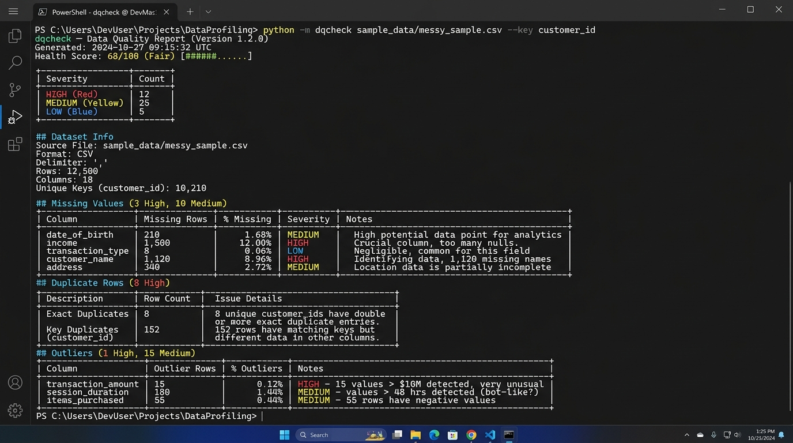

# dqcheck

Command-line CSV data quality validation tool for machine learning pipelines and exploratory data analysis.

`dqcheck` inspects raw tabular CSV data and evaluates statistical anomalies, structural defects, and data-hygiene risks prior to feature engineering and model training.



---

## Architectural Comparison

| Dimension | dqcheck | General Profiling Tools (ydata-profiling, sweetviz) |
|-----------|---------|-----------------------------------------------------|
| Primary Objective | Pre-modeling data hygiene and validation | Exploratory data analysis and visual distribution plots |
| Dependency Footprint | Minimal standard stack (pandas, numpy) | Multi-package stack with plotting and visualization libraries |
| Output Format | Terminal stdout, Markdown, standalone HTML | Complex multi-tab browser dashboard |
| Quality Metric | Unified 0-100 health score | None (manual visual inspection required) |
| Execution Context | Headless CLI, CI/CD automated gates, notebooks | Interactive exploratory notebook sessions |
| Data Modification | Pure read-only validation | Pure read-only validation |

---

## Installation

```bash
git clone https://github.com/Shubham-2025S/dqcheck.git
cd dqcheck
pip install -r requirements.txt
```

Requirements: Python 3.9+, pandas, numpy, pytest.

---

## Quick Start

```bash
# Analyze a CSV file and output Markdown to stdout
python -m dqcheck dataset.csv

# Run with key-duplicate validation across composite entity keys
python -m dqcheck dataset.csv --key customer_id,order_date

# Generate a self-contained HTML report
python -m dqcheck dataset.csv --format html --output report.html

# Use Z-score outlier detection instead of IQR
python -m dqcheck dataset.csv --outlier-method zscore

# Custom correlation threshold
python -m dqcheck dataset.csv --corr-threshold 0.85

# Add domain-specific missing value sentinels
python -m dqcheck dataset.csv --missing-tokens "missing,unavailable,9999"
```

A sample HTML report is available at [docs/sample_report.html](docs/sample_report.html).

---

## CLI Options

```text
usage: dqcheck [-h] [--key KEY] [--format {md,html}] [--output OUTPUT]
               [--outlier-method {iqr,zscore}]
               [--corr-threshold CORR_THRESHOLD]
               [--missing-tokens MISSING_TOKENS]
               csv_file
```

| Flag | Type | Default | Description |
|------|------|---------|-------------|
| `csv_file` | Positional | (Required) | Path to target CSV file |
| `--key` | String | None | Comma-delimited column names representing entity primary/natural keys |
| `--format` | String | `md` | Output format: `md` (Markdown) or `html` (standalone HTML) |
| `--output` | String | stdout | Destination file path for generated report |
| `--outlier-method` | String | `iqr` | Outlier calculation algorithm: `iqr` or `zscore` |
| `--corr-threshold` | Float | `0.9` | Absolute Pearson correlation coefficient threshold for collinearity |
| `--missing-tokens` | String | Built-in | Comma-separated additional strings to treat as missing values |

---

## Checks and Methodology

### 1. Ingestion and Dtype Validation
- Loads CSV with encoding fallback (`utf-8` then `latin-1`).
- Validates structural shape and non-empty file contents.
- Heuristically inspects string-typed (`object`/`string`) columns for masked numeric values (e.g., currency symbols, percent signs, commas) and dates (`YYYY-MM-DD`, `ISO 8601`) that pandas failed to infer.

### 2. Missing Value Detection
- **Standard Nulls:** Counts `NaN`, `None`, and empty tokens natively parsed by pandas.
- **Hidden Sentinels:** Detects masked missing values by trimming whitespace and evaluating normalized tokens against known sentinels: `""`, `"?"`, `"-"`, `"na"`, `"n/a"`, `"null"`, `"none"`, `"nan"`, plus user-supplied tokens.
- **Severity Tiers:**
  - Low: `< 5%` missing.
  - Medium: `5%` to `30%` missing.
  - High: `> 30%` missing (columns exceeding `50%` missing trigger a column-drop recommendation).

### 3. Duplicate Records
- **Full-Row Duplicates:** Identifies exact duplicate rows across all features using `df.duplicated()`.
- **Key Duplicates:** When primary key columns are specified via `--key`, verifies if identical key values contain conflicting values in remaining attribute columns (indicating data corruption, merge collisions, or race conditions).

### 4. Outlier Analysis
- **IQR Method (Default):**
  $$\text{IQR} = Q_3 - Q_1$$
  $$\text{Lower Bound} = Q_1 - 1.5 \times \text{IQR}, \quad \text{Upper Bound} = Q_3 + 1.5 \times \text{IQR}$$
  Non-parametric and robust against skewed distributions.
- **Z-Score Method (Optional):**
  $$z = \frac{x - \mu}{\sigma}, \quad |z| > 3.0$$
  Parametric test suited for approximately Gaussian distributions.
- Flags extreme values for inspection without modifying underlying data.

### 5. Distribution Skewness
- Measures Fisher-Pearson standardized moment coefficient using unbiased sample estimators:
  - Symmetric: $|s| < 0.5$
  - Moderately Skewed: $0.5 \le |s| \le 1.0$ (Medium severity)
  - Highly Skewed: $|s| > 1.0$ (High severity)
- Validates whether feature domain is strictly positive ($x > 0$) before recommending logarithmic transformations ($\log(x)$).

### 6. Multicollinearity (Pearson Correlation)
- Calculates bivariate correlation matrix across numeric features:
  $$r = \frac{\sum (x_i - \bar{x})(y_i - \bar{y})}{\sqrt{\sum (x_i - \bar{x})^2 \sum (y_i - \bar{y})^2}}$$
- Evaluates the upper triangular matrix to prevent duplicate pair reporting and self-correlations ($r=1.0$).
- Flags feature pairs where $|r| \ge \text{threshold}$ (default `0.90`).

### 7. Structural Integrity
- **Constant Features:** Flags columns having $\le 1$ unique value (`nunique <= 1`), as zero-variance columns provide no predictive information.
- **High-Cardinality Identifiers:** Flags columns where unique value ratio exceeds $90\%$ of total records combined with identifier naming patterns (`id`, `uuid`, `pk`, `key`, etc.).

---

## Health Score Formula

The overall dataset health score is calculated deductively from a base of 100:

$$\text{Score} = \max\left(0, \min\left(100, 100 - (10 \times N_{\text{high}}) - (3 \times N_{\text{medium}}) - (1 \times N_{\text{low}})\right)\right)$$

| Score Range | Grade | Description |
|-------------|-------|-------------|
| 90 – 100 | Excellent | Data is well-structured with negligible issues |
| 70 – 89 | Good | Minor missingness or moderate skewness detected |
| 50 – 69 | Fair | Multiple issues requiring imputation or transforms |
| 30 – 49 | Poor | Substantial data hygiene risks present |
| 0 – 29 | Critical | High proportion of nulls, duplicates, or corrupt keys |

---

## Sample Terminal Output

```text
# dqcheck — Data Quality Report

**Health Score: 68/100 (Fair)**

| Severity | Count |
|----------|-------|
| HIGH     | 3     |
| MEDIUM   | 4     |
| LOW      | 2     |
| INFO     | 1     |

_Health score formula: start at 100, deduct 10 per high, 3 per medium, 1 per low finding. Min 0._

## Dataset Info

- **File:** `sample_data/messy_sample.csv`
- **Rows:** 200
- **Columns:** 12

| Column | Dtype |
|---|---|
| id | int64 |
| customer_id | object |
| name | object |
| age | object |
| salary | int64 |
| score | float64 |
| city | object |
| signup_date | object |
| notes | object |
| constant_col | object |
| price | object |
| discount_pct | object |

### Dtype Warnings

- **age**: stored as `object`, but looks like `numeric`. Examples: ['400', '28']
- **price**: stored as `object`, but looks like `numeric`. Examples: ['$1200', '$800']
- **discount_pct**: stored as `object`, but looks like `numeric`. Examples: ['10%', '15%']
- **signup_date**: stored as `object`, but looks like `date`. Examples: ['2024-01-15']

## Missing Values
_Found missing values in 3/12 columns (1 high, 1 medium, 1 low severity)._

### [HIGH] notes
- **Check:** missing
- **Severity:** high
- **Metric:** 65/200 (32.5%)
- **Details:** Column 'notes' has 65 missing values (32.5% of 200 rows). 45 are standard NaN/None, and 20 are hidden missing values (sentinel strings like '?', 'N/A', etc.).
```

---

## Test Suite

```bash
pytest tests/ -v
```

Contains 79 tests covering:
- CSV encoding, empty/corrupt files, dtype parsing
- Missing value calculations and hidden sentinel detection
- Full-row duplicates and key-conflict detection
- IQR and Z-score outlier boundaries and edge cases (zero IQR, zero variance)
- Fisher-Pearson skewness measurement and logarithmic transformation rules
- Upper-triangle Pearson collinearity checks
- Structural constant and identifier feature validation
- Report formatting and end-to-end integration

---

## License

MIT License. See [LICENSE](LICENSE) for details.
